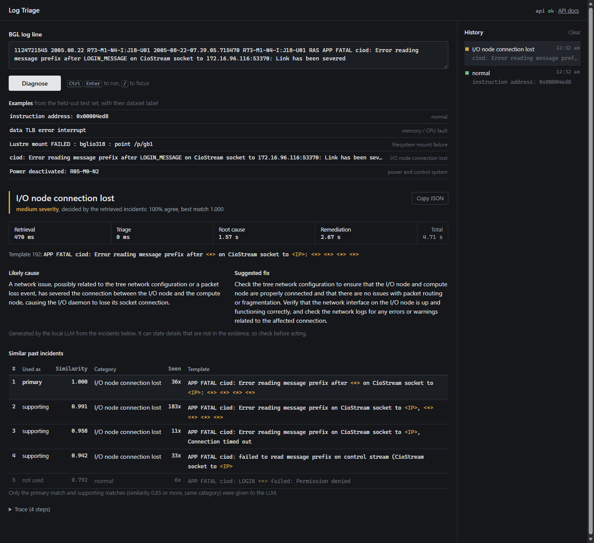
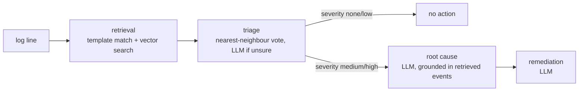
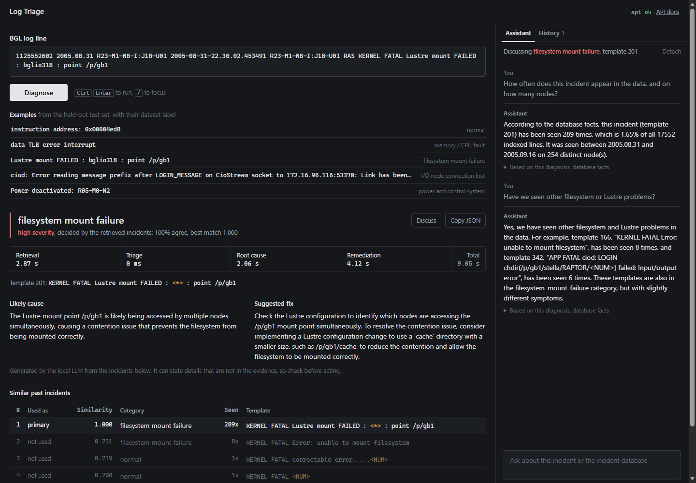

# RAG-Based System Log Triage

[](https://github.com/aditya6v/RAG-Based-System-Log-Triage-System/actions/workflows/tests.yml)

Classifies a single system log line, decides whether it needs attention, and for real
alerts suggests a likely root cause and a fix. Classification is done by retrieving similar
past log events. A local LLM writes the explanation from those events.

Built and evaluated on the BGL (BlueGene/L supercomputer) log from Loghub [1, 2].



## How it works



1. **Retrieval.**
   - The dataset's label token is removed.
   - The line is matched to a known template with Drain [3, 4].
   - The template is embedded with `nomic-embed-text`, and the 5 most similar past
     incidents are fetched from Qdrant.
   - Their counts and labels come from MongoDB.
2. **Triage.** The retrieved incidents vote on one of 8 categories (`bgl/categories.json`).
   If the vote is not confident, the LLM decides instead.
3. **Router.** The category's severity decides the path. Normal lines stop here with no LLM call.
4. **Root cause** and **remediation.** Two LLM prompts. The closest match is passed as
   primary evidence. Other matches are passed only if they are similar enough and share
   the same category.

The index is built offline. A sample of the log is parsed into 357 templates, stored in
MongoDB and embedded into Qdrant.

### LLM providers

LLM calls go through a chain set by `LLM_PROVIDER_CHAIN`, by default
`groq,openrouter,ollama`.
- **Fallback.** 429, 5xx and timeouts are retried twice (honouring `Retry-After`, capped
  at 10 s), then the next provider is tried. A bad key or unknown model moves on at once.
- **Offline last resort.** The local Ollama model (`llama3.2:3b`) needs no key or network,
  so a demo keeps working when the hosted free tiers are exhausted or offline.
- **Accounting.** Every response says which provider answered, with token counts
  (`llm_calls`, `provider`).

**Privacy.** Before text goes to a hosted provider, `agents/redact.py` replaces:
- IP addresses
- BGL node locations (`R23-M1-N8-I:J18-U01`) and I/O host names (`bglio318`)
- user names in paths (`/home/<user>`, `/p/gb1/<user>`)
- hardware serials, e-mail addresses and long tokens

It's pattern matching, so an identifier in an unusual format would get through. Set
`REDACT_HOSTED=0` to turn it off. Ollama runs locally and always sees the original text.

**Embeddings don't fall back.** The index and the queries must use the same model, so
embeddings come from one provider only: Ollama's `nomic-embed-text`, or the same model
in-process with `EMBED_PROVIDER=fastembed` (no Ollama needed). The two were checked against
each other (`scripts/compare_embeddings.py`):
- cosine 1.0000 on all 357 templates
- the same top-5 incidents for 100 of 100 test lines

**Size of calls**, measured on the local model:
- A full diagnosis makes 2 LLM calls with 476–699 prompt tokens and about 110 reply tokens
  in total. A normal line makes none.
- An assistant turn is about 1,400–1,550 prompt tokens.

### Assistant



The side panel holds a conversation about the current diagnosis, using the same local
model. Click **Discuss** on a result, or pick one of the suggested questions. On every
question, the server (`agents/chat.py`) builds the model's context from:

- **The diagnosis on screen:** line, category, severity, cause, fix, and the retrieved
  incidents, each marked as used or not used as evidence.
- **Database lookups:**
  - per-category counts and definitions
  - for the matched template: line count and share of all lines, distinct nodes, first and
    last date in the log
  - the most frequent other incidents in the same category
- **A vector search on the question itself.** Results are kept only if similarity is 0.65
  or more, because prose questions rarely resemble log templates.

The model doesn't query the database itself: a 3B model is unreliable at choosing tools.
The server does fixed lookups, computes numbers such as percentages, and the model writes
the answer. Replies stream as they are generated. Log text is passed as quoted data, and the
model is told not to follow instructions inside it.

## Results

8 categories. Two test sets, both held out from the index:
- **Random split:** 623 lines sampled from the whole log.
- **Time split:** the index is built from the first 60% of the log (June–July 2005) and the
  test set is 632 lines from the last 30% (September 2005 – January 2006).

Full details, per-class scores and confusion matrices: [docs/EVALUATION.md](docs/EVALUATION.md).

| Method | Random split | Time split | Time split, normal FATAL/ERROR lines left alone (150) |
|---|---|---|---|
| Always "normal" (majority class) | 0.482 | 0.475 | 1.000 |
| "FATAL or FAILURE means alert" (alert vs normal only) | 0.876 | 0.840 | 0.327 |
| LLM only (`llama3.2:3b`) | 0.425 | 0.432 | 0.000 |
| LLM with retrieved events | 0.639 | 0.492 | 0.027 |
| TF-IDF + logistic regression | 0.982 | 0.884 | 1.000 |
| Nearest-neighbour vote | 0.981 | 0.888 | 0.993 |
| Vote, LLM when unsure (earlier rule) | 0.982 | 0.699 | 0.413 |
| **Vote, "unknown" when unsure (used)** | **0.993 precision**, answers 97.6% | **0.971 precision**, answers 86.6% | n/a |

What these show:
- **A plain text classifier is as accurate as retrieval here.** TF-IDF with logistic
  regression ties the nearest-neighbour vote, because BGL's alert messages barely vary.
  Retrieval's value in this system is the evidence behind each explanation, not higher
  accuracy.
- **Testing on later logs costs about 0.1 accuracy**, and one category (filesystem
  failures) never occurs in the older logs at all.
- **The service abstains instead of guessing.** Below a confidence threshold, chosen on a
  separate validation period, it answers "unknown" and shows the LLM's pick as an
  unverified suggestion. The earlier rule, which used the LLM's pick as the answer, fell to
  0.699 on later logs because the 3B model labels unfamiliar normal lines as alerts.

Latency on a laptop CPU, models already loaded:
- A normal line takes 0.2–0.7 s (no LLM call).
- A full diagnosis takes 5.5–7.5 s.

## Quickstart

**Requirements**
- Python 3.12
- [Ollama](https://ollama.com)
- A MongoDB Atlas cluster and a Qdrant cluster (free tiers are enough)

```powershell
python -m venv venv
.\venv\Scripts\Activate.ps1
pip install -r requirements.txt
ollama pull llama3.2:3b
ollama pull nomic-embed-text
copy .env.example .env      # then fill in the values in <...>
```

**Build the index** (about 4 minutes):

```powershell
python -m ingestion.ingest sample_data/bgl_index.log
python -m embeddings.embed
```

**Run:**

```powershell
uvicorn api.main:app --port 8000
```

- Web page: http://localhost:8000
- API docs: http://localhost:8000/docs

The first request takes about 10 s while Ollama loads the models.

```bash
curl -X POST http://localhost:8000/diagnose -H "Content-Type: application/json" \
  -d '{"raw_log": "1125552602 2005.08.31 R23-M1-N8-I:J18-U01 2005-08-31-22.30.02.453491 R23-M1-N8-I:J18-U01 RAS KERNEL FATAL Lustre mount FAILED : bglio318 : point /p/gb1"}'
```

The response includes:
- `classification`, `severity`, `route`
- `root_cause`, `remediation`
- `retrieved` (similar incidents with scores) and `evidence` (which of them were used)
- `timings_ms` per step

`POST /chat` takes `{"messages": [{"role": "user", "content": "..."}], "context": <a /diagnose
response or null>}`. It streams newline-delimited JSON:
- one `context` event listing the related incidents found for the question
- `delta` events carrying text
- a final `done` (or `error`) event

Limits: at most 40 messages, 4,000 characters per message, and 20,000 characters of context.

**Docker:**

```bash
docker compose up --build
```

The container uses Ollama on the host. MongoDB Atlas and Qdrant stay external.

## Configuration

All settings are read from `.env` (see `.env.example`).

| Variable | Default | Meaning |
|---|---|---|
| `MONGO_URI` | required | MongoDB connection string |
| `MONGO_DB_NAME` | set in `.env.example` | Database for this index |
| `QDRANT_URL`, `QDRANT_API_KEY` | required | Qdrant cluster |
| `QDRANT_COLLECTION` | set in `.env.example` | Collection for this index |
| `LLM_PROVIDER_CHAIN` | `groq,openrouter,ollama` | Chat providers in order; hosted ones without a key are skipped. If unset, the older `LLM_PROVIDER` value is used |
| `GROQ_API_KEY`, `GROQ_MODEL` | empty, `llama-3.3-70b-versatile` | Groq. Model names on free tiers change; check the console |
| `OPENROUTER_API_KEY`, `OPENROUTER_MODEL` | empty, `meta-llama/llama-3.3-70b-instruct:free` | OpenRouter |
| `REDACT_HOSTED` | `1` | Mask identifiers before text goes to a hosted provider |
| `LLM_TIMEOUT_S` | `30` | Per-request timeout for hosted providers |
| `OLLAMA_CHAT_MODEL`, `OLLAMA_EMBED_MODEL` | `llama3.2:3b`, `nomic-embed-text` | Local models. The embedding model must match the one the index was built with |
| `EMBED_PROVIDER` | `ollama` | `ollama` or `fastembed` (same model, in-process) |
| `OLLAMA_KEEP_ALIVE` | `30m` | How long Ollama keeps models loaded |

## Tests and evaluation

```powershell
python -m pytest -q                                 # 95 tests; no database, LLM or network needed
python -m eval.evaluate eval/bgl_eval.jsonl --no-llm   # retrieval-only methods, about 3 min
python -m eval.evaluate eval/bgl_eval.jsonl         # all methods, about 25 min on CPU
python scripts/run_samples.py                       # five demo lines through the API
```

To regenerate the index sample and test set from the full log, download `BGL.zip`
from https://zenodo.org/records/8196385 and extract it to `data/bgl/` (not in git). Then run:

```powershell
python -I scripts/sample_bgl.py data/bgl/BGL.log
```

## Project layout

```
api/            FastAPI app: /diagnose, /categories, /health, web page at /
agents/         pipeline: retrieval, classify (vote + LLM), graph (steps and routing), llm
bgl/            BGL line format and the category definitions (categories.json)
ingestion/      Drain3 wrapper and the ingest job
embeddings/     embedding job (MongoDB -> Qdrant)
db/             MongoDB and Qdrant clients
eval/           evaluation script, test set, saved results
scripts/        dataset scan, sampling, demo runner
frontend/       single HTML page, no build step
tests/          pytest suite
docs/           evaluation, design notes, runbook, references
```

## Limitations

- **The explanations invent details.** There's no ground truth for root causes. An automatic
  check found that 5.4% of generated sentences, in 19% of diagnoses, name a file path,
  number or component that appears nowhere in the evidence, such as made-up Lustre config
  files. It undercounts. A stricter prompt made this worse (9.6%) and was reverted. Trust
  the evidence table; treat the text as a starting point.
- **Matching known alerts is easy on BGL.** BGL has only 88 distinct alert messages after
  masking numbers. Results on unseen patterns and on normal lines logged at FATAL/ERROR level
  are the fairer measure, and the unseen alert subsets are small.
- **New failure types can't be named.** A category absent from the index (filesystem
  failures, on the time split) is at best answered "unknown": 38 of 50 were, and 12 were
  wrongly called normal. The abstain threshold was tuned on one validation period of one
  dataset.
- **One dataset; single lines only.** Problems that show only as a sequence of normal-looking
  lines are out of scope.
- **Cloud services required.** MongoDB and Qdrant must be reachable; there is no offline mode.
- **The assistant can still misread its context.** Counts, dates and same-category incidents
  come from the database and were answered correctly in the checks so far. But asked whether
  the fix is supported by evidence, it once treated generated text as evidence. Its answers
  have not been scored systematically.

More in [docs/DESIGN_NOTES.md](docs/DESIGN_NOTES.md).

## Documentation

- [docs/EVALUATION.md](docs/EVALUATION.md): data, split, all results and how they were produced
- [docs/DESIGN_NOTES.md](docs/DESIGN_NOTES.md): design decisions, rejected approaches, limitations
- [docs/RUNBOOK.md](docs/RUNBOOK.md): running a demo, common faults and fixes, rebuilding the databases
- [docs/REFERENCES.md](docs/REFERENCES.md): papers, datasets and software used

## References

[1] A. Oliner and J. Stearley. "What Supercomputers Say: A Study of Five System Logs." DSN 2007.<br>
[2] J. Zhu, S. He, P. He, J. Liu, M. R. Lyu. "Loghub: A Large Collection of System Log Datasets for AI-driven Log Analytics." ISSRE 2023.<br>
[3] P. He, J. Zhu, Z. Zheng, M. R. Lyu. "Drain: An Online Log Parsing Approach with Fixed Depth Tree." ICWS 2017.<br>
[4] Drain3. https://github.com/logpai/Drain3

Full list in [docs/REFERENCES.md](docs/REFERENCES.md).
