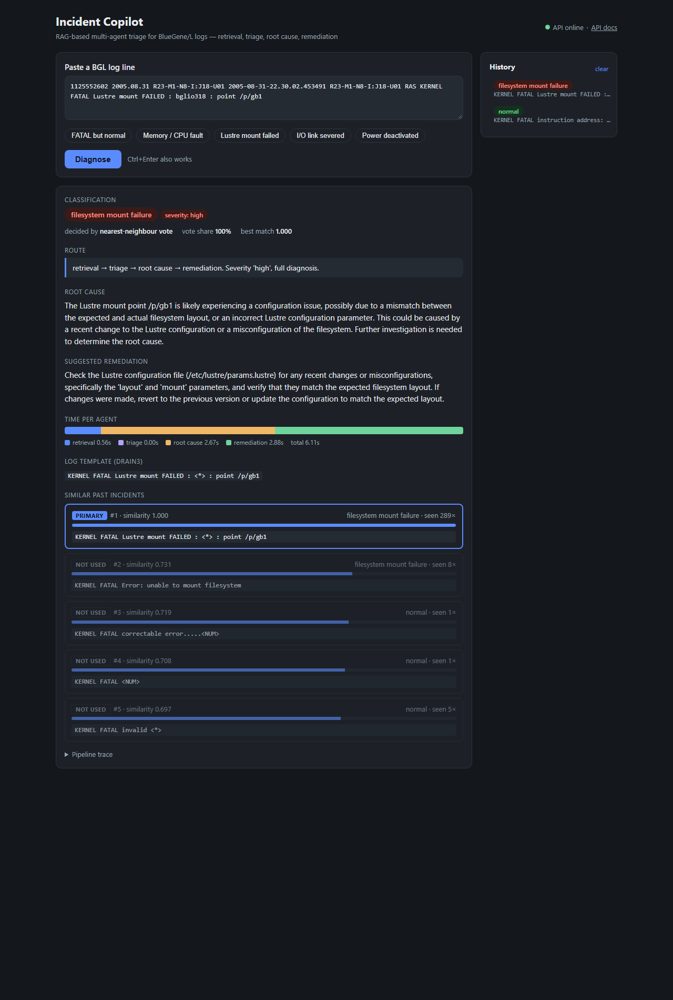
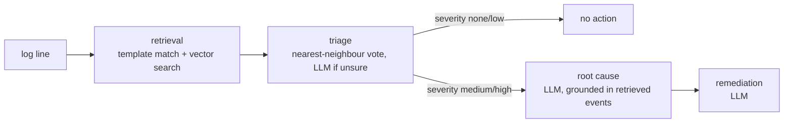

# RAG-Based System Log Triage

Classifies a single system log line, decides whether it needs attention, and for real
alerts suggests a likely root cause and a fix. Classification is done by retrieving similar
past log events. A local LLM writes the explanation from those events.

Built and evaluated on the BGL (BlueGene/L supercomputer) log from Loghub [1, 2].



## How it works



1. **Retrieval.**
   - The dataset's label token is removed.
   - The line is matched to a known template with Drain [3, 4].
   - The template is embedded with `nomic-embed-text`, and the 5 most similar past
     incidents are fetched from Qdrant.
   - Their counts and labels come from MongoDB.
2. **Triage.** The retrieved incidents vote on one of 8 categories (`bgl/categories.json`).
   If the vote is not confident, the LLM decides instead.
3. **Router.** The category's severity decides the path. Normal lines stop here with no LLM call.
4. **Root cause** and **remediation.** Two prompts to `llama3.2:3b` via Ollama. The closest
   match is passed as primary evidence. Other matches are passed only if they are similar
   enough and share the same category.

The index is built offline. A sample of the log is parsed into 357 templates, stored in
MongoDB and embedded into Qdrant.

## Results

623 test lines held out from the index, 8 categories. Full details, per-class scores and
confusion matrices: [docs/EVALUATION.md](docs/EVALUATION.md).

| Method | Accuracy | Accuracy on unseen message patterns (151) | Normal FATAL/ERROR lines correctly left alone (108) |
|---|---|---|---|
| "FATAL or FAILURE means alert" | 0.876 (alert vs normal only) | n/a | 0.287 |
| LLM only (`llama3.2:3b`) | 0.425 | 0.212 | 0.000 |
| LLM with retrieved events | 0.639 | 0.570 | 0.028 |
| Nearest-neighbour vote | 0.981 | 0.921 | 1.000 |
| **Vote, LLM when unsure (used)** | **0.982** | **0.927** | 0.981 |

Latency on a laptop CPU, models already loaded:
- A normal line takes 0.2–0.7 s (no LLM call).
- A full diagnosis takes 5.5–7.5 s.

Read these numbers with the limitations below in mind. In particular, alerts that match a
known pattern are close to a lookup.

## Quickstart

**Requirements**
- Python 3.12
- [Ollama](https://ollama.com)
- A MongoDB Atlas cluster and a Qdrant cluster (free tiers are enough)

```powershell
python -m venv venv
.\venv\Scripts\Activate.ps1
pip install -r requirements.txt
ollama pull llama3.2:3b
ollama pull nomic-embed-text
copy .env.example .env      # then fill in the values in <...>
```

**Build the index** (about 4 minutes):

```powershell
python -m ingestion.ingest sample_data/bgl_index.log
python -m embeddings.embed
```

**Run:**

```powershell
uvicorn api.main:app --port 8000
```

- Web page: http://localhost:8000
- API docs: http://localhost:8000/docs

The first request takes about 10 s while Ollama loads the models.

```bash
curl -X POST http://localhost:8000/diagnose -H "Content-Type: application/json" \
  -d '{"raw_log": "1125552602 2005.08.31 R23-M1-N8-I:J18-U01 2005-08-31-22.30.02.453491 R23-M1-N8-I:J18-U01 RAS KERNEL FATAL Lustre mount FAILED : bglio318 : point /p/gb1"}'
```

The response includes:
- `classification`, `severity`, `route`
- `root_cause`, `remediation`
- `retrieved` (similar incidents with scores) and `evidence` (which of them were used)
- `timings_ms` per step

**Docker:**

```bash
docker compose up --build
```

The container uses Ollama on the host. MongoDB Atlas and Qdrant stay external.

## Configuration

All settings are read from `.env` (see `.env.example`).

| Variable | Default | Meaning |
|---|---|---|
| `MONGO_URI` | required | MongoDB connection string |
| `MONGO_DB_NAME` | set in `.env.example` | Database for this index |
| `QDRANT_URL`, `QDRANT_API_KEY` | required | Qdrant cluster |
| `QDRANT_COLLECTION` | set in `.env.example` | Collection for this index |
| `LLM_PROVIDER` | `ollama` | `ollama` or `gemini` |
| `OLLAMA_CHAT_MODEL`, `OLLAMA_EMBED_MODEL` | `llama3.2:3b`, `nomic-embed-text` | Models. The embedding model must match the one the index was built with |
| `OLLAMA_KEEP_ALIVE` | `30m` | How long Ollama keeps models loaded |

## Tests and evaluation

```powershell
python -m pytest -q                                 # 54 tests; no database or LLM needed
python -m eval.evaluate eval/bgl_eval.jsonl --no-llm   # retrieval-only methods, about 3 min
python -m eval.evaluate eval/bgl_eval.jsonl         # all methods, about 25 min on CPU
python scripts/run_samples.py                       # five demo lines through the API
```

To regenerate the index sample and test set from the full log, download `BGL.zip`
from https://zenodo.org/records/8196385 and extract it to `data/bgl/` (not in git). Then run:

```powershell
python -I scripts/sample_bgl.py data/bgl/BGL.log
```

## Project layout

```
api/            FastAPI app: /diagnose, /categories, /health, web page at /
agents/         pipeline: retrieval, classify (vote + LLM), graph (steps and routing), llm
bgl/            BGL line format and the category definitions (categories.json)
ingestion/      Drain3 wrapper and the ingest job
embeddings/     embedding job (MongoDB -> Qdrant)
db/             MongoDB and Qdrant clients
eval/           evaluation script, test set, saved results
scripts/        dataset scan, sampling, demo runner
frontend/       single HTML page, no build step
tests/          pytest suite
docs/           evaluation, design notes, runbook, references
```

## Limitations

- **Only classification is measured.** The dataset has no ground truth for root causes. On
  the cases read by hand, the 3B model sometimes invents details, such as wrong expansions
  of acronyms or file paths that aren't in the data.
- **Matching known alerts is easy on BGL.** BGL has only 88 distinct alert messages after
  masking numbers. Results on unseen patterns and on normal lines logged at FATAL/ERROR level
  are the fairer measure, and the unseen alert subsets are small.
- **Not tested on a different time period.** The test set is not split from the index by
  time, and simple text classifiers (e.g. TF-IDF with logistic regression) have not been
  compared yet.
- **One dataset; single lines only.** Problems that show only as a sequence of normal-looking
  lines are out of scope.
- **Cloud services required.** MongoDB and Qdrant must be reachable; there is no offline mode.

More in [docs/DESIGN_NOTES.md](docs/DESIGN_NOTES.md).

## Documentation

- [docs/EVALUATION.md](docs/EVALUATION.md): data, split, all results and how they were produced
- [docs/DESIGN_NOTES.md](docs/DESIGN_NOTES.md): design decisions, rejected approaches, limitations
- [docs/RUNBOOK.md](docs/RUNBOOK.md): running a demo, common faults and fixes, rebuilding the databases
- [docs/REFERENCES.md](docs/REFERENCES.md): papers, datasets and software used

## References

[1] A. Oliner and J. Stearley. "What Supercomputers Say: A Study of Five System Logs." DSN 2007.<br>
[2] J. Zhu, S. He, P. He, J. Liu, M. R. Lyu. "Loghub: A Large Collection of System Log Datasets for AI-driven Log Analytics." ISSRE 2023.<br>
[3] P. He, J. Zhu, Z. Zheng, M. R. Lyu. "Drain: An Online Log Parsing Approach with Fixed Depth Tree." ICWS 2017.<br>
[4] Drain3. https://github.com/logpai/Drain3

Full list in [docs/REFERENCES.md](docs/REFERENCES.md).
