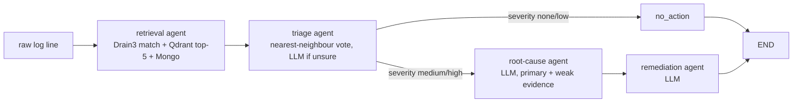
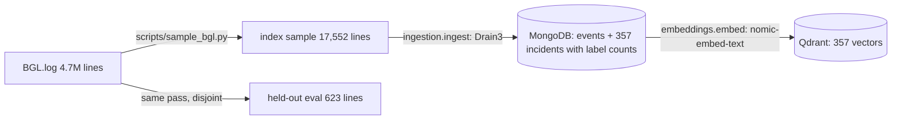

# Incident Copilot: end-term notes for the report

Factual notes for writing the ETE report and slides. Every number here comes
from a command that was run. The command and the result file are named next
to it. Build history is in `PROGRESS.md`.

## 1. What the system does

One BGL log line goes in. Out come a category, a severity, a root cause, a
suggested fix, the similar past incidents that justify it, and how long each
agent took.

Offline (batch) path that builds the knowledge base:

Stack: Python 3.12, FastAPI + Uvicorn, LangGraph, Drain3, MongoDB Atlas (free),
Qdrant Cloud (free), Ollama (`llama3.2:3b` chat, `nomic-embed-text` 768-dim
embeddings, local), scikit-learn for metrics, Docker. Gemini is optional.

## 2. Midterm vs end-term

| | Midterm (git tag `midterm`) | End-term |
|---|---|---|
| Data | 10 fabricated OpenStack-style lines, 4 templates | Real Loghub BGL: 17,552-line index, 623-line held-out eval |
| Categories | 4, hard-coded in the prompt | 8, from 41 real alert codes, in one file (`bgl/categories.json`) |
| Agents | 2 combined (triage+retrieval, diagnosis+remediation) | 4 (retrieval, triage, root cause, remediation) + deterministic router |
| Routing | Linear; the normal-log guard was dead code (defined twice) | Conditional edge on severity; normal logs skip both LLM diagnosis calls |
| Classification | LLM only | Nearest-neighbour vote; LLM only when the vote is unsure |
| Grounding | All 3 hits given equal weight | Top hit = primary; weak hits must score >= 0.85 and share the triage label |
| Drain3 at query time | Learned from every query (changed saved state) | Read-only match |
| Eval | 10 lines that were also in the index | 623 held-out lines, seen/unseen/hard-negative subsets, 5 classifiers compared |
| API | Flask, HTML error pages | FastAPI, Pydantic models, `/docs`, JSON errors |
| UI | Result card | Severity badges, route, evidence roles, per-agent timings, history |
| Tests | none | pytest suite (no DB or LLM needed) |
| Deployment | `python app.py` | `uvicorn` or `docker compose up` |

Midterm baseline, re-run 2026-10-26 on the tagged code: accuracy 0.90, weighted F1 0.86,
macro F1 0.71 on its 10 synthetic lines. The normal log got a made-up disk-space root
cause, and 3 of 4 diagnoses blamed disk space. Details in `PROGRESS.md`.

## 3. The data story

**OpenStack (Loghub), considered and rejected.** `openstack_abnormal.log` has
18,434 lines and zero ERROR lines. Its 4 anomalous instances are unusual
*sequences* of INFO events (for example VM started, paused, resumed during spawn),
not failure text in any single line. That is a sequence-anomaly problem
(DeepLog-style), not per-line triage. Recorded as future work.

**BGL (Loghub), chosen.** Full scan of `BGL.log` (`scripts/scan_bgl.py`,
`scripts/scan_bgl_overlap.py`, about 30 s per streaming pass):

- 4,747,963 lines; 348,460 alert lines (7.3%); 41 alert codes over 215 days.
- 34,470 normal lines have no message at all: skipped.
- **Alert text barely varies.** With numbers masked, the 41 codes have only 88
  distinct messages, and 26 codes have exactly one. Classifying alerts is close to a
  template lookup.
- **Normal lines look scary.** About 618k normal lines are logged at FATAL, ERROR,
  SEVERE or FAILURE (for example "idoproxydb hit ASSERT condition", 84k lines at
  ERROR). Every alert is FATAL or FAILURE. These "hard negatives" are what
  separates a real classifier from a keyword rule.
- **Contradictory labels.** "program interrupt" appears 3,662 times as normal and
  5 times as KERNPROG. KERNPROG is mapped to normal, with the reason in
  `bgl/categories.json`.

**Categories.** 41 codes grouped by meaning into 7 alert categories plus normal
(`bgl/categories.json`): memory/CPU fault, kernel crash, I/O node connection
lost, filesystem mount failure, job launch failure, link/network hardware,
power and control system. Each has a definition and a severity.

**Sampling** (`scripts/sample_bgl.py`, seed 7, one streaming pass, never fully in memory):
- Each line gets a "pattern key" (category + component + level + masked message).
- About 10% of normal patterns and about 20% of alert patterns per category (never
  the most common one) are held out of the index entirely. These form the
  eval's **unseen** subset.
- **Seen** subset: reservoir sample per category, so it is frequency-weighted
  like the real log.
- Normal lines are split half and half between hard negatives and ordinary lines.
- No line is in both the index and the eval (asserted by the script).

| category | index lines | eval seen | eval unseen |
|---|---|---|---|
| normal | 15,520 | 200 | 100 |
| memory_cpu_fault | 311 | 40 | 9 |
| kernel_crash | 311 | 40 | 8 |
| io_connection_lost | 309 | 40 | 6 |
| filesystem_mount_failure | 303 | 40 | 3 |
| job_launch_failure | 305 | 40 | 6 |
| link_hardware_failure | 183 | 32 | 5 |
| power_control_failure | 310 | 40 | 14 |

The eval has 108 hard negatives. The ground-truth label token is stripped
before Drain3, the embedding model or the LLM see a line (`bgl/lines.py`,
tested).

**Drain3 tuning.** Measured on the index (share of lines whose cluster's majority
label is their own):

| sim_th | clusters | purity |
|---|---|---|
| 0.4 | 237 | 98.3% |
| 0.5 | 268 | 99.5% |
| 0.6 | 309 | 99.6% |
| 0.7 | 357 | 99.97% |
| 0.8 | 410 | 99.98% |

0.7 was chosen. At 0.4, short messages merge on "KERNEL FATAL" alone.

## 4. Evaluation

**Setup.** `python -m eval.evaluate eval/bgl_eval.jsonl`. 623 held-out BGL lines, none in
the index; llama3.2:3b on local Ollama (CPU), nomic-embed-text. Result files:
`eval/results/20261026-153603.json` (every prediction) and `.md` (report). The run took 1,609 s.
Only the **classification** step is scored. The dataset has no ground truth for root
cause or remediation.

Five classifiers on exactly the same retrieval results:
- `level_rule`: FATAL/FAILURE means alert (binary only)
- `knn_vote`: similarity-weighted vote of the retrieved incidents' labels, only hits within 0.05 of the best
- `llm_only`: the LLM given only the category definitions
- `llm_rag`: the LLM also shown the 5 retrieved incidents with their labels
- `triage`: what the app does. The vote when top score >= 0.9 and vote share >= 0.6, otherwise `llm_rag`

| classifier | accuracy (8 classes) | macro F1 | unseen-pattern accuracy (151) | alert vs normal accuracy | hard negatives correct (108) |
|---|---|---|---|---|---|
| level_rule | n/a | n/a | n/a | 0.876 | 0.287 |
| knn_vote | 0.981 | 0.981 | 0.921 | 0.981 | 1.000 |
| llm_only | 0.425 | 0.446 | 0.212 | 0.650 | 0.000 |
| llm_rag | 0.639 | 0.755 | 0.570 | 0.727 | 0.028 |
| **triage** | **0.982** | 0.974 | **0.927** | **0.997** | 0.981 |

Triage per class (all 623): normal F1 0.997, memory/CPU 0.893 (precision 0.852), kernel crash
0.970, I/O connection 1.000, filesystem 1.000, job launch 1.000, link hardware 0.958 (recall
0.919), power/control 0.971. Confusion matrices are in the `.md` report.

**How to read these numbers honestly**
1. "Seen" lines (472) score 100% for the vote. That is close to a lookup, because BGL alert text
   barely varies (section 3). The **unseen** subset (92.7%) and the **hard negatives** are the
   real test. Unseen alert subsets are small (3–14 lines per category), so treat per-class
   unseen numbers as indicative.
2. Retrieval does the classifying, not the LLM. The 3B LLM alone gets 42.5% and calls every
   FATAL-level normal line an alert (0/108). Giving it the retrieved neighbours raises it to
   63.9%, which is still far below the vote. The answer to "does RAG help?" is yes, by a lot,
   but mainly through the retrieved *labels*, not through the LLM's reasoning.
3. The LLM fallback is nearly neutral. On the 33 lines where triage used it, it was right
   22 times and the vote would have been right 21 times. The thresholds were set before
   the run, not tuned on the eval set.
4. A keyword rule is a strong-looking but misleading baseline: 87.6% alert-vs-normal
   accuracy, yet it flags 71% of the scary-looking normal lines.
5. The first vote implementation scored 0.753 (see section 5). Keep both numbers. It shows
   the eval caught a real design bug.

**Latency** (same machine, CPU only, models already loaded):
- Retrieval median 0.25 s (p90 0.26 s); LLM classify median 0.65 s (alone) / 1.59 s (with neighbours).
- End to end over real HTTP to the running server (`eval/results/samples-stage3-http.json`):
  - Normal line, warm: 0.68 s, no LLM call (retrieval only).
  - Full diagnosis, warm: 6.3–7.4 s, of which root cause is 2.1–3.7 s and remediation 3.0–3.5 s.
  - Cold start: the first request after the server starts waits for Ollama to load each
    model: 7.8 s for the embedding model, and 8.8 s extra on the first root-cause call
    for the chat model. Send one request before a live demo.

**Diagnosis quality** (5 demo lines, read by hand):
- All 5 were classified correctly.
- Every evidence item given to the root-cause agent matched the triage label. That fixes the
  midterm problem of blending in unrelated incidents.
- The small model still invents specifics, such as expanding "RAS" wrongly or naming config file
  paths that are not in the data. Plausible in general, not trustworthy in detail.

## 5. Design decisions worth explaining

- **Retrieval before triage.** The plan had triage first. It was reversed because the
  vote classifier needs the retrieved incidents.
- **Vote margin (a real bug found by the eval).** The first nearest-neighbour vote
  weighted all 5 hits by similarity. 312 of the 357 incidents are normal, so an exact
  match (score 1.0, correct label) was regularly outvoted by three normal incidents
  at about 0.75. That run lost 136 alert lines (accuracy 0.753,
  `eval/results/20261026-143929-naive-vote.md`). Now only hits within 0.05 of the
  best match vote (accuracy 0.981, same eval).
- **Deterministic router.** The severity comes from `categories.json`, not from the LLM,
  so the route can't be talked into the wrong branch, and it's unit-tested.
- **Evidence filter.** Similarity alone separates related from unrelated
  incidents poorly with this embedding model. Among the stored incidents' top-5
  neighbours, same-label pairs have median 0.828 and different-label pairs 0.786, and
  25% of different-label pairs still score >= 0.85. So weak evidence must also share
  the triage label.
- **Read-only Drain3 at query time.** The midterm's `add_log_message` learned from
  every diagnose request and rewrote `drain3_state.bin`, so templates drifted
  from what was embedded. `match_line` only looks up, and a test checks the state is unchanged.
- **Qdrant over Atlas Vector Search.** Qdrant runs locally as well as in a free cloud
  tier. Atlas Vector Search is a valid alternative. No detailed comparison was done.
- **Ollama as primary LLM.** Availability for a live demo (no rate limits or 503s),
  at the cost of a smaller model.

## 6. Known limitations

_Filled in at the end of the build._

## 7. Likely examiner questions

_Filled in at the end of the build._
